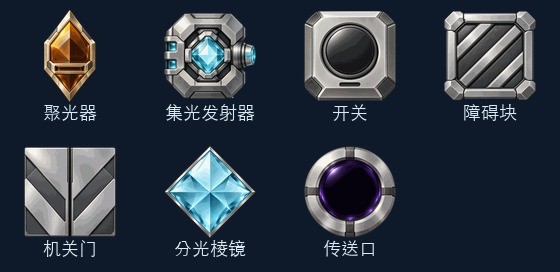
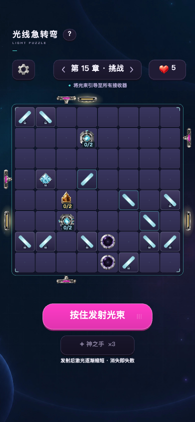
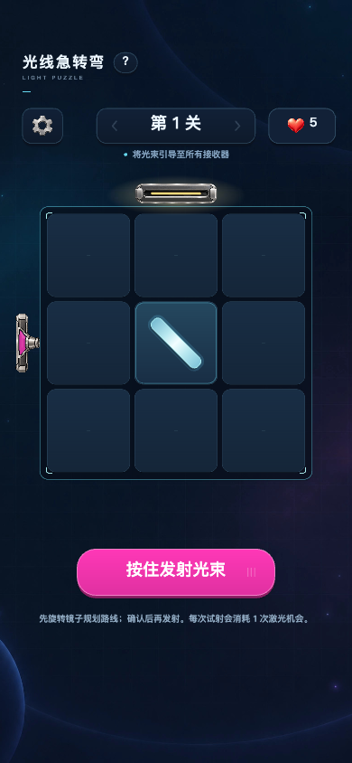

# 棋盘机关素材 · 2026-10-14

采用内置 image_gen 为聚光器、集光发射器、开关、障碍块、机关门、分光棱镜、传送口生成七张独立透明 PNG。材质沿用发射台的钛银、石墨与光学玻璃；金色尖棱形、青色八角腔体、圆形按钮、实体斜纹障碍和传送镜面保留各自可辨识的轮廓。

提示词与原图来源见 [mechanism-assets.json](mechanism-assets.json)。原图保存在生成目录，运行时采用 [public/ui/mechanisms](../public/ui/mechanisms) 中 256 × 256 的裁切、缩放与调色板压缩版本，保留 alpha 透明通道。七张图合计 107,924 字节。

## 游戏内接入

- 图片负责静态材质，实时图形负责配对颜色、方向轴、计数、充能、信号与命中反馈。开关点亮后按钮浮现配对色；门叶共享一张图片并按纹理区域分为左右两片，保留原有打开过程。
- 集光发射器的整张图片随输出方向旋转，文字保持正向；蓄力和释放动效继续作用于新图。聚光器的进度条放入图片下部接收槽。
- 贴图加载失败时使用原有矢量外观。图片切换不修改关卡数据、玩法状态或光路起点。
- 第 1～5 个普通关卡的发射器分别采用原尺寸的 72%、78%、84%、90%、96%；第 6 关起与挑战关仍采用正常尺寸。缩放时以喷口为前端锚点，激光起点保持连接。

## 检查

- 类型检查、加载资源异常处理、光学、机关与布局验证通过；布局检查覆盖 96 组边缘布局和 200 关解法。
- 浏览器检查第 1 关、第 15 章挑战、第 39 关及独立机关场景；检查开关激活、门叶打开、集光器蓄力与释放，以及深色和白色主题。
- Web 与微信构建通过；微信主包约 2.79 MiB。未进行小游戏真机验证。

预览 `/tools/visual/tutorial.html?stage=boss:15&learned=1&theme=aurora` 使用内存存档；机关动态场景可打开 `/tools/visual/optics.html?scene=mechanisms&theme=aurora&renderer=fallback-high`。

