# UI 升级 · 2026-10-13

本次采用精致轻科幻风格，完成获胜页、金币/爱心状态栏和棋盘边缘光学设备的更新。

## 已接入

- 获胜面板调整为 560 × 600，标题、关卡、提示、奖励分层；主操作「下一关」全宽，两个次操作并列放在下方。无奖励时压缩为 488 高。
- 爱心与金币共用右上方 136 × 76 的位置和基线。金币中心固定，长金额自动缩放，飞入终点不随数字变动。
- 六张独立生成的透明 PNG：香槟金金币、珊瑚红爱心、皇冠、钛银齿轮、发射器和接收器。设备金属外壳使用图片，光色、充能、命中和多次接收标记实时绘制。
- 素材缺失保留矢量回退；异步换纹理保留飞行金币的隐藏状态；零奖励不会因加载素材出现奖励图标。
- 飞金币的散开、上升、飞行、翻转、计数与时间参数沿用已有实现。关卡推进和挑战关逻辑未修改。

## 素材

使用内置 image_gen，逐张生成，以金币作为统一材质参考。完整提示词、原始文件位置及最终文件名见 [ui-refresh-assets.json](ui-refresh-assets.json)。原图保存在记录中的生成目录，运行时只打包 public/ui 中的裁切、缩放与 PNG 调色板压缩版本。

| 资源 | 尺寸 | 大小 |
| --- | --- | --- |
| victory-coin.png | 256 × 256 | 19,061 B |
| heart.png | 256 × 256 | 9,743 B |
| victory-crown.png | 384 × 384 | 31,850 B |
| settings-gear.png | 256 × 256 | 12,814 B |
| emitter.png | 222 × 512 | 20,684 B |
| receiver.png | 125 × 512 | 14,600 B |

六张合计 108,752 B。微信主包 2.63 MB / 4 MB；全部 UI 约 0.49 MB。

## 验证

- 类型检查、光学、机关、渲染布局、引导检查通过；覆盖 96 组边缘布局和 200 关解法。
- 三主题 × 四视口（360 × 740、375 × 667、390 × 844、430 × 932），含 64 px 安全区，面板均在视口内。
- 浏览器验证奖励 20 正确入账、打断时只结算一次、七位余额限制在 64 逻辑像素、飞行终点固定、延迟换纹理不提前显示金币、零奖励紧凑布局、设备回退。
- 点击下一关、选择关卡及预览本关，分别进入后续关卡、选关页及海报预览。
- Web、微信构建通过。存在原有 Vite 大 chunk 提示和微信打包选项提示；未进行微信真机验证。

## 预览

开发服务器下打开 `/tools/visual/tutorial.html?level=2&learned=1&theme=void&overlay=result`。该页面使用内存存档，不更改玩家进度。去掉 overlay=result 可查看棋盘；theme 可改为 aurora 或 white。

| 调整前 | 调整后 |
| --- | --- |
| 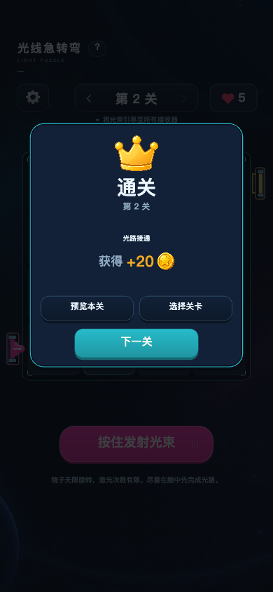 | 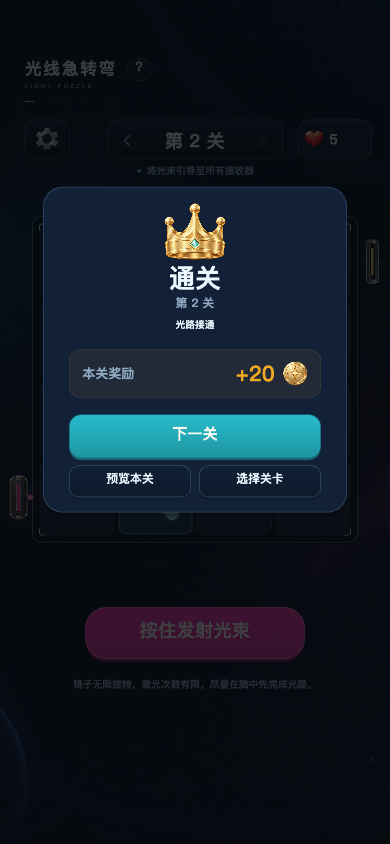 |

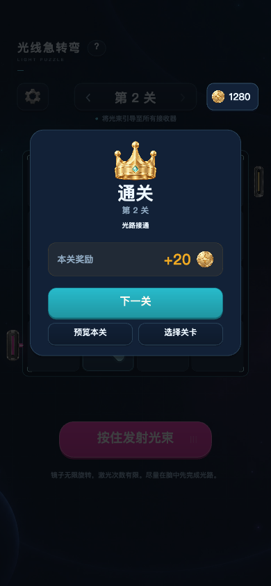

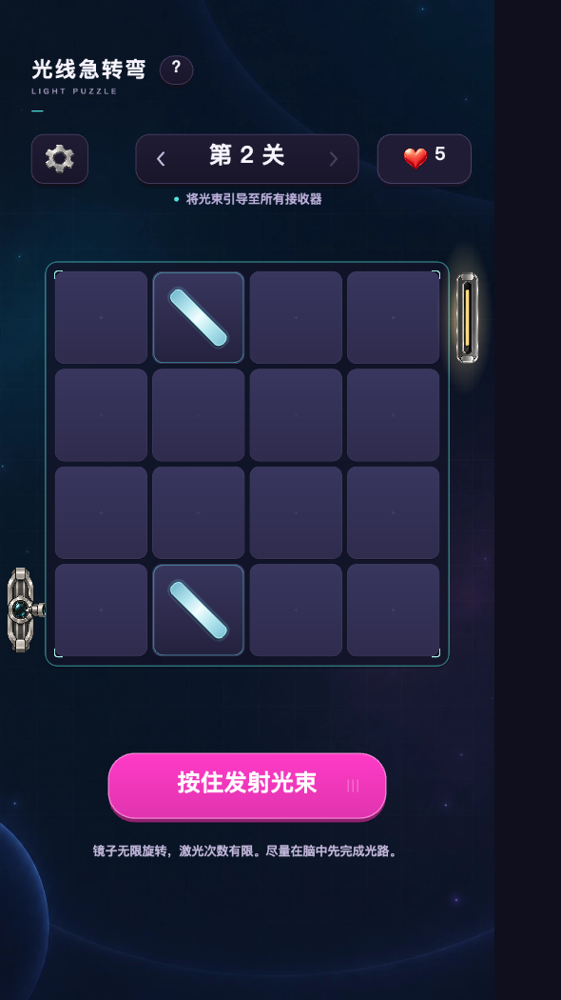

## 发射器备选

最终采用用户指定的第 4 个棱镜发射器。金属框与喷口沿用原图，中央青色宝石已从贴图中移除，留下透明窗口。其余四张保留在 [备选目录](qa/emitter-variants)，运行时仅打包修改后的第 4 个。

| 1 · 短炮管 | 2 · 聚焦镜头 | 3 · 双导轨 | 4 · 棱镜头（已接入） | 5 · 环形核心 |
| --- | --- | --- | --- | --- |
| 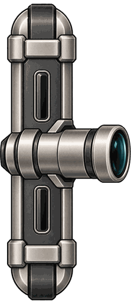 | 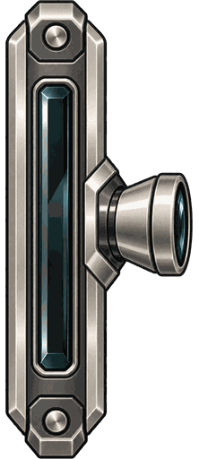 | 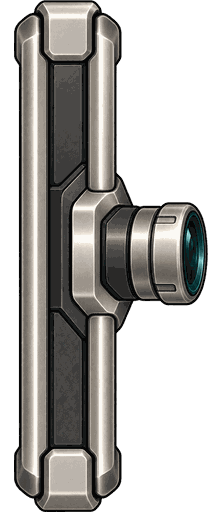 | 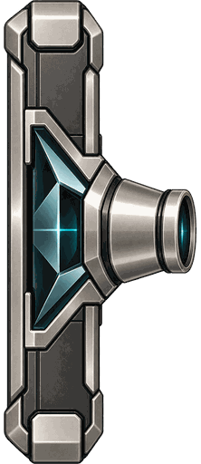 | 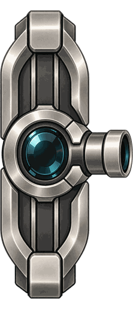 |

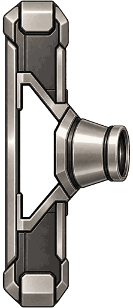

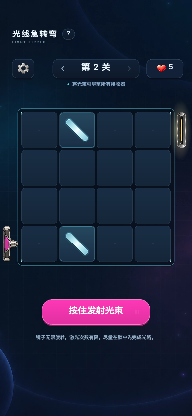

## 后续调整：设备尺寸、顶部状态栏与蓄力中段

- 关卡文字取消旧的下移补偿；爱心图标和数字按实际总宽度居中，四位数字仍保留边距。
- 发射台采用用户指定的第 4 张棱镜头，中央窗口是真实 alpha 透明；贴图下方用游戏矢量图形填充当前激光色，并加少量同色棱面。贴图加载后隐藏旧矢量发射台的纵向亮条、出口线和纵向光晕，避免在图片上重复描绘。
- 发射台及接收台长度取格子宽的 94%，随 3×3、4×4、6×6 等棋盘的格子大小变化；原有光学起点和接收点不变。棋盘外侧边距为大尺寸贴图留出空间。
- 蓄力进度约 23%～81% 之间将旧圆环与逐渐伸长的宽光束过渡成短聚焦线，起始聚光和末段释放继续沿用原有节奏。
- 已检查三主题、360/390/590 px 宽视口以及 3×3、4×4、6×6 和其他关卡，设备贴图保持在关卡可见区域内。

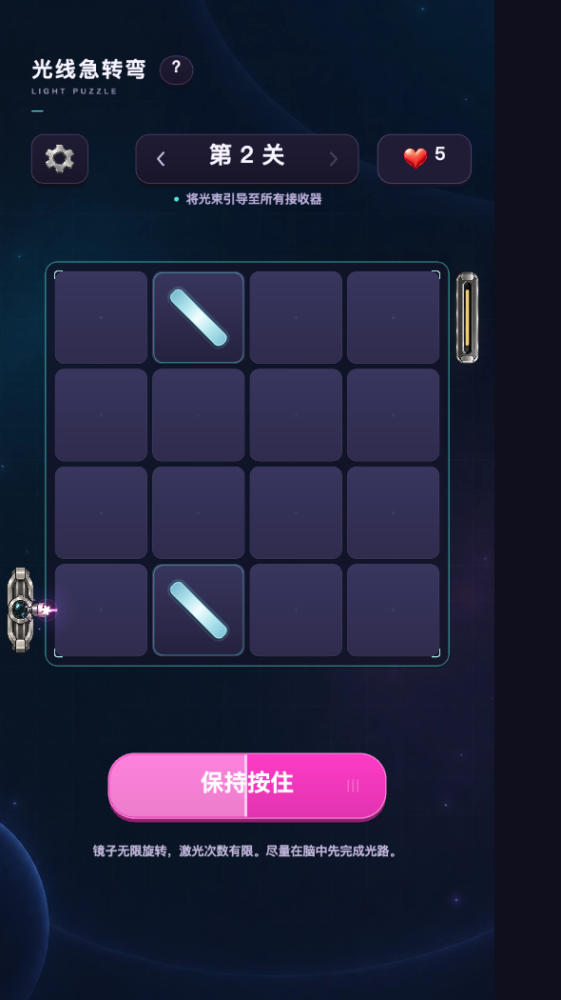

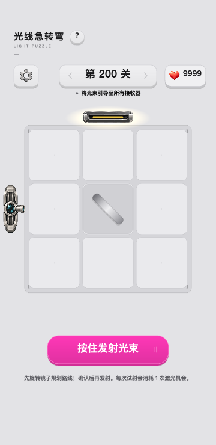

## 棱镜颜色检查

默认粉色、冰川蓝、琥珀金都使用同一张无色镂空金属图，窗口颜色由激光选项实时决定。

| 冰川蓝 | 琥珀金 |
| --- | --- |
| 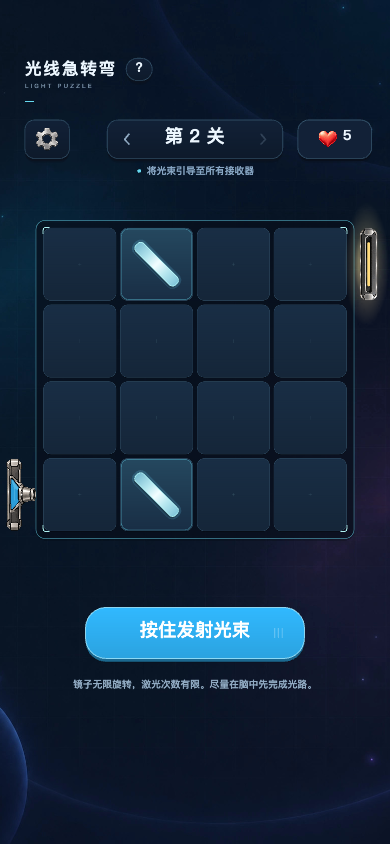 | 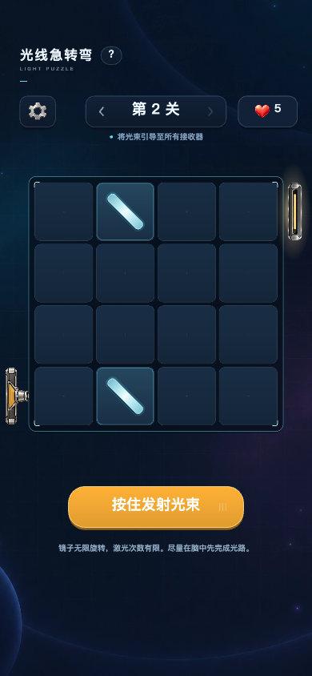 |
